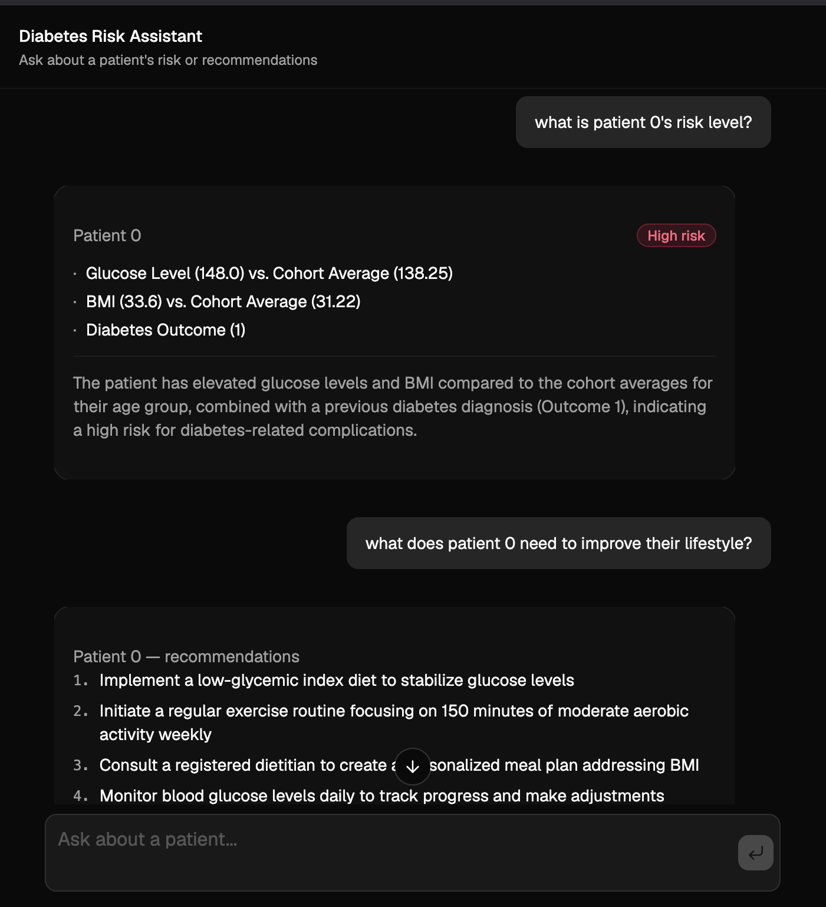

# Agentic Diabetes Risk Assistant

A multi-agent AI system that assesses diabetes risk and generates targeted health
recommendations, built with the OpenAI Agents SDK. An orchestrator agent classifies
user intent and routes requests to specialized agents, each with structured,
type-safe outputs enforced via Pydantic.

## Overview

This project explores agentic AI architecture — autonomous, tool-calling agents
that reason over data and make context-dependent decisions — applied to a
real-world healthcare use case using the [Pima Indians Diabetes Dataset](https://www.kaggle.com/datasets/shahnawaj9/diabetes-database).

Rather than a single LLM call, the system is composed of three cooperating agents:

- **Orchestrator Agent** — classifies incoming queries and routes them to the
  appropriate downstream agent, chaining agents together when needed.
- **Risk Assessment Agent** — uses tool-calling to look up patient data and,
  when a value looks borderline, autonomously decides to pull cohort-level
  context before producing a structured risk assessment.
- **Recommendation Agent** — takes a structured risk assessment and generates
  concrete, prioritized lifestyle recommendations targeted at the specific
  risk factors identified.

## Architecture


**Flow:**
1. User submits a natural language query within a chat session (e.g. *"How risky does patient 0 look?"*)
2. Orchestrator reads the conversation history and session state, classifies intent
   (`risk_only` or `recommendation`) and resolves the patient, including follow-ups
   like *"what should they do?"*
3. If the patient has a cached assessment whose data, prompt version and model are
   unchanged, it is reused; otherwise the Risk Agent runs with tool access to patient
   records and cohort averages, deciding for itself whether cohort comparison is needed
4. If a recommendation was requested, the structured assessment is passed to the
   Recommendation Agent, which produces targeted advice
5. A typed result (`risk_assessment`, `recommendation` or `clarification`) is returned,
   and a compact summary is written back to conversation memory

## Memory & Context Management

| Layer | Purpose | Implementation |
|---|---|---|
| Conversation memory | What was said | Agents SDK `SQLiteSession`, capped at `SESSION_HISTORY_LIMIT` items per turn |
| Working state | What the system knows: active patient, cached assessments | `ConversationState` in `memory/state.py`, injected into the orchestrator prompt as a one-line summary |
| Context isolation | Each agent sees only what it needs | Sub-agents never receive the transcript; the Recommendation Agent only gets the structured assessment |

Assessments are cached under `(patient_id, record_hash, prompt_version, model)`, so a
follow-up recommendation skips a full risk-agent run. Large tool outputs are never
replayed into history; only a short result summary is stored.

## Tech Stack

- **Python**
- **OpenAI Agents SDK** — agent orchestration, tool-calling, structured outputs
- **Pydantic** — schema definition and validation for all agent outputs
- **Pandas** — data cleaning and cohort/record lookups
- **FastAPI** — versioned REST API with typed, discriminated responses
- **React + TypeScript** — chat frontend
- **GPT-4o-mini** — default model for all agents, configurable per role

## Data

Source data: [Pima Indians Diabetes Dataset](https://www.kaggle.com/datasets/shahnawaj9/diabetes-database).

Cleaning steps applied:
- Identified and handled disguised missing values (zeros used as placeholders
  for missing measurements in `Glucose`, `BloodPressure`, `SkinThickness`,
  `Insulin`, `BMI`)
- Dropped rows with small counts of missing values (under ~5% missing)
- Median-imputed columns with larger gaps in missing data (`SkinThickness`, `Insulin`)
- `patient_id` is the row's position in the source CSV, assigned before cleaning so ids stay stable
- The `Outcome` label is never exposed to agents, so the risk assessment cannot read the answer

> Note: a Snowflake medallion architecture (bronze/silver/gold) was designed
> for this pipeline as a planned extension; the current implementation runs
> against a locally cleaned dataframe. See [Future Work](#future-work).

## Setup

1. Clone the repo:
```bash
git clone https://github.com/anshdeepb/agentic_ai_diabetes.git
cd agentic_ai_diabetes/backend
```

2. Create a virtual environment and install dependencies:
```bash
python -m venv .venv
source .venv/bin/activate
pip install -r requirements-dev.txt
```

3. Create `backend/.env` with your OpenAI API key. Any setting in `backend/config.py`
   can be overridden here too (e.g. `DEFAULT_MODEL`, `RISK_MODEL`, `SESSION_HISTORY_LIMIT`):
```
OPENAI_API_KEY=your_key_here
```

4. Run the API and the frontend:
```bash
uvicorn main:app --reload
```
```bash
cd ../frontend && npm install && npm run dev
```

## API

| Method | Path | Description |
|---|---|---|
| `POST` | `/v1/sessions/{session_id}/messages` | Send a query; body `{"query": "..."}` |
| `DELETE` | `/v1/sessions/{session_id}` | Clear a session's history and state |
| `GET` | `/healthz` | Liveness check |

```json
{
  "session_id": "3f6c...",
  "result": { "type": "risk_assessment", "assessment": { "...": "..." }, "from_cache": false }
}
```

## Testing

```bash
pytest
```
Unit and API tests run without network access by stubbing the agent runner.
`python scripts/smoke_test.py` runs a live three-turn conversation against the model.



## What Makes This "Agentic"

Unlike a single prompt-response system, the Risk Assessment Agent makes an
autonomous decision mid-reasoning: after examining a patient's raw data, it
independently determines whether the values are clearly normal, clearly
high-risk, or borderline — only calling the cohort-comparison tool in the
borderline case rather than following a fixed sequence every time.

## Future Work

- Migrate the data layer to a full Snowflake medallion pipeline (bronze/silver/gold)
  for production-grade data infrastructure
- Add role-based agents (patient, doctor, scheduling staff) with access-controlled
  routing through the orchestrator
- Add a cohort comparison agent and availability/scheduling agent
- Deterministic risk-score model exposed as a tool, with the LLM explaining the score
- Input/output guardrails and an offline eval suite in CI
- Streaming responses, Postgres/Redis-backed memory and tracing

## Author

*Anshdeep Bhachoo*