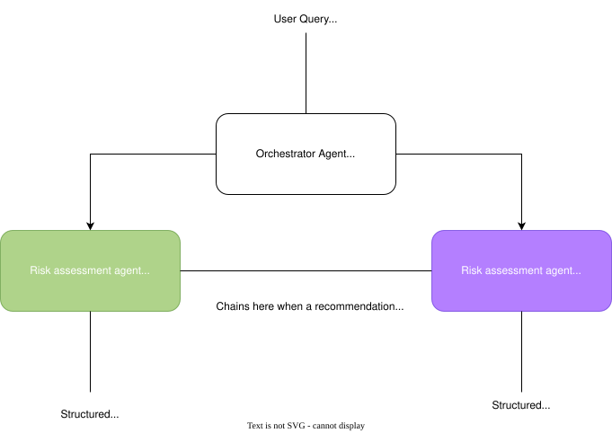

# Agentic Diabetes Risk Assistant

A multi-agent AI system that assesses diabetes risk and generates targeted health
recommendations, built with the OpenAI Agents SDK. An orchestrator agent classifies
user intent and routes requests to specialized agents, each with structured,
type-safe outputs enforced via Pydantic.

## Overview

This project explores agentic AI architecture — autonomous, tool-calling agents
that reason over data and make context-dependent decisions — applied to a
real-world healthcare use case using the [Pima Indians Diabetes Dataset](https://www.kaggle.com/datasets/shahnawaj9/diabetes-database).

Rather than a single LLM call, the system is composed of three cooperating agents:

- **Orchestrator Agent** — classifies incoming queries and routes them to the
  appropriate downstream agent, chaining agents together when needed.
- **Risk Assessment Agent** — explains a deterministic risk score from a trained
  logistic regression model; for borderline (Medium) scores it calls a cohort-comparison
  tool to add context before producing a structured risk assessment.
- **Recommendation Agent** — takes a structured risk assessment and generates
  concrete, prioritized lifestyle recommendations targeted at the specific
  risk factors identified.

Every request is screened by input guardrails, and agent outputs by a clinical safety
guardrail, before anything reaches the user.

## Architecture



**Flow:**
1. User submits a natural language query within a chat session (e.g. *"How risky does patient 0 look?"*)
2. Orchestrator reads the conversation history and session state, classifies intent
   (`risk_only` or `recommendation`) and resolves the patient, including follow-ups
   like *"what should they do?"*
3. If the patient has a cached assessment whose data, prompt version, risk model and
   LLM are unchanged, it is reused; otherwise the risk model scores the patient and the
   Risk Agent explains the score, pulling cohort averages for borderline cases
4. If a recommendation was requested, the structured assessment is passed to the
   Recommendation Agent, which produces targeted advice
5. A typed result (`risk_assessment`, `recommendation` or `clarification`) is returned,
   and a compact summary is written back to conversation memory

## Memory & Context Management

| Layer | Purpose | Implementation |
|---|---|---|
| Conversation memory | What was said | Agents SDK `SQLiteSession`, capped at `SESSION_HISTORY_LIMIT` items per turn |
| Working state | What the system knows: active patient, cached assessments | `ConversationState` in `memory/state.py`, injected into the orchestrator prompt as a one-line summary |
| Context isolation | Each agent sees only what it needs | Sub-agents never receive the transcript; the Recommendation Agent only gets the structured assessment |

Assessments are cached under `(patient_id, record_hash, prompt_version, model)`, so a
follow-up recommendation skips a full risk-agent run. Large tool outputs are never
replayed into history; only a short result summary is stored.

## Tech Stack

- **Python**
- **OpenAI Agents SDK** — agent orchestration, tool-calling, structured outputs
- **Pydantic** — schema definition and validation for all agent outputs
- **Pandas** — data cleaning and cohort/record lookups
- **scikit-learn** — risk model training (dev only; inference has no ML dependency)
- **FastAPI** — versioned REST API with typed, discriminated responses
- **React + TypeScript** — chat frontend
- **GPT-4o-mini** — default model for all agents, configurable per role

## Data

Source data: [Pima Indians Diabetes Dataset](https://www.kaggle.com/datasets/shahnawaj9/diabetes-database).

Cleaning steps applied:
- Identified and handled disguised missing values (zeros used as placeholders
  for missing measurements in `Glucose`, `BloodPressure`, `SkinThickness`,
  `Insulin`, `BMI`)
- Dropped rows with small counts of missing values (under ~5% missing)
- Median-imputed columns with larger gaps in missing data (`SkinThickness`, `Insulin`)
- `patient_id` is the row's position in the source CSV, assigned before cleaning so ids stay stable
- The `Outcome` label is never exposed to agents, so the risk assessment cannot read the answer

> Note: a Snowflake medallion architecture (bronze/silver/gold) was designed
> for this pipeline as a planned extension; the current implementation runs
> against a locally cleaned dataframe. See [Future Work](#future-work).

## Setup

1. Clone the repo:
```bash
git clone https://github.com/anshdeepb/agentic_ai_diabetes.git
cd agentic_ai_diabetes/backend
```

2. Create a virtual environment and install dependencies:
```bash
python -m venv .venv
source .venv/bin/activate
pip install -r requirements-dev.txt
```

3. Create `backend/.env` with your OpenAI API key. Any setting in `backend/config.py`
   can be overridden here too (e.g. `DEFAULT_MODEL`, `RISK_MODEL`, `SESSION_HISTORY_LIMIT`):
```
OPENAI_API_KEY=your_key_here
```

4. Run the API and the frontend:
```bash
uvicorn main:app --reload
```
```bash
cd ../frontend && npm install && npm run dev
```

## API

| Method | Path | Description |
|---|---|---|
| `POST` | `/v1/sessions/{session_id}/messages` | Send a query; body `{"query": "..."}` |
| `DELETE` | `/v1/sessions/{session_id}` | Clear a session's history and state |
| `GET` | `/healthz` | Liveness check |

```json
{
  "session_id": "3f6c...",
  "result": { "type": "risk_assessment", "assessment": { "...": "..." }, "from_cache": false }
}
```

## Testing

```bash
pytest
```
Unit and API tests run without network access by stubbing the agent runner.
`python scripts/smoke_test.py` runs a live three-turn conversation against the model.

## Evaluation

Agent behaviour is measured with three eval suites that call the real models
(`backend/evals/`). Each metric has a threshold, and the command exits non-zero if any
suite fails, so it can gate CI.

| Suite | Question it answers | Method | Key metrics |
|---|---|---|---|
| `routing` | Does the orchestrator pick the right intent and patient, including follow-ups and clarifications? | 20 golden conversations (`evals/datasets/routing.json`); downstream agents are stubbed so only routing is tested | turn accuracy, conversation pass rate, accuracy per tag |
| `risk` | Does the risk level agree with the real diagnosis, are cited numbers real, and does the agent use tools as intended? | Balanced sample of held-out patients scored against the `Outcome` label, which agents never see | ordinal and probability AUC, High recall, false-High rate, agent/model band agreement, numeric grounding, cohort-tool use outside borderline cases |
| `guardrails` | Are attacks blocked without blocking real users? | 40 cases (`evals/datasets/guardrails.json`): 21 off-topic, injection and unsafe requests, and 19 legitimate questions including follow-ups and near-misses | attack block rate ≥ 0.90, false block rate ≤ 0.05, block rate per category |
| `recommendation` | Are actions targeted, specific, prioritized and safe? | LLM-as-judge (`JUDGE_MODEL`, default `gpt-4o`) with a rubric, plus format checks | pass rate, safety rate, average rubric scores |

```bash
cd backend
python -m evals                        # all suites
python -m evals routing                # one suite
python -m evals risk --limit 40 --seed 1
```

Runs use a throwaway database, print a summary, and write a full JSON report with
per-case details to `backend/evals/reports/` (gitignored). The default run makes roughly
150 model calls.


## Safety & Guardrails

Every message and every agent output passes through layered checks.

| Layer | What it checks | How |
|---|---|---|
| Input rules | Blatant prompt injection ("ignore previous instructions", "reveal your system prompt", role-play overrides) | Regex, no model call |
| Input classifier | Off-topic requests, subtler injection, and unsafe requests (diagnosis, medication, dosing, treatment changes) | `gpt-4o-mini` classifier (`GUARD_MODEL`) with the conversation state, so follow-ups like "what should they do?" stay allowed |
| Output guardrail | Drug names, dosages, treatment instructions and diagnosis statements in risk explanations and recommendations | Agents SDK output guardrail with deterministic patterns |

Blocked inputs return a `refusal` result with a fixed message and are never written to
conversation history or session state, so an injection attempt cannot be replayed into
later turns. The input check runs before the orchestrator for this reason: the SDK's
built-in input guardrails persist the tripped message to the session.

If an agent's output trips the output guardrail, it is retried once with feedback. If it
trips again, risk explanations fall back to a template built from the model score, and
recommendations return a refusal pointing the user to a clinician.

## Risk Model

Risk levels come from a logistic regression model, not from the LLM. The model is trained
on 75% of the cleaned data with a stratified split; the remaining 25% is held out for
evaluation, and the eval suite only samples from those held-out patients.

| | |
|---|---|
| Cross-validated AUC (train) | 0.84 ± 0.03 |
| Held-out AUC | 0.82 |
| Bands | Low < 20% · Medium 20–45% · High ≥ 45% |
| Diabetic rate per band (held-out) | Low 7% · Medium 50% · High 69% |
| High recall on diabetic patients (held-out) | 0.47 (gate: ≥ 0.50, **currently failing**) |
| False-High rate on non-diabetic patients (held-out) | 0.115 (gate: ≤ 0.25) |
| Diabetic patients rated Low (held-out) | 6 of 66 (9%) |

**Known gap:** cross-validation on the training split predicted High recall of about 0.66,
but on the held-out set it is 0.47, so the `risk` eval suite fails its High-recall gate.
The band cut-offs are deliberately not re-tuned on the held-out set, since that would make
its numbers meaningless; the gate stays until a better model (evaluated with
cross-validation) clears it.

Bands were chosen for screening using out-of-fold predictions on the training split only:
Low should mean low (≤ 10% diabetic), and High catches about two-thirds of diabetic
patients while keeping false alarms near one in six. Each score also carries its top
contributing features and clinical reference flags (2-hour OGTT glucose ≥ 140 / ≥ 200,
BMI ≥ 25 / ≥ 30, diastolic pressure ≥ 80 / ≥ 90, age ≥ 45).

The trained model is stored as plain JSON (`backend/artifacts/risk_model.json`):
coefficients, scaling parameters, bands, metrics and held-out patient ids. Inference is a
few lines of arithmetic, so the API needs no scikit-learn and loads no pickled code.
Retrain with:

```bash
python scripts/train_risk_model.py
```

The model version is a fingerprint of its parameters and is part of the assessment cache
key, so retraining invalidates cached assessments automatically.

## What Makes This "Agentic"

The work is split between what must be deterministic and what benefits from reasoning.
The risk band is computed, not generated, and the final assessment always uses it. The
Risk Agent decides how to explain it: for borderline (Medium) scores it chooses to call
the cohort-comparison tool and folds that context into its reasoning, while clear Low or
High cases skip the extra call. Whether the cohort tool was used is read from the actual
tool calls in the run, not from the model's own claim, and the eval suite checks that
the agent only reaches for it in borderline cases.

## Future Work

- Migrate the data layer to a full Snowflake medallion pipeline (bronze/silver/gold)
  for production-grade data infrastructure
- Add role-based agents (patient, doctor, scheduling staff) with access-controlled
  routing through the orchestrator
- Add a cohort comparison agent and availability/scheduling agent
- Improve the risk model's High recall (e.g. gradient boosting or feature interactions, compared with cross-validation)
- Run the eval suite in CI
- Streaming responses, Postgres/Redis-backed memory and tracing

## Author

*Anshdeep Bhachoo*